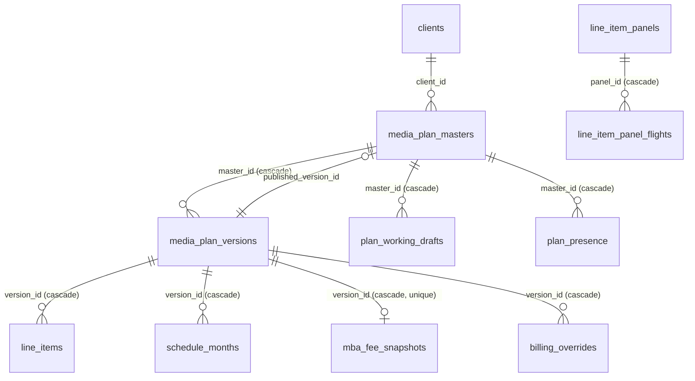
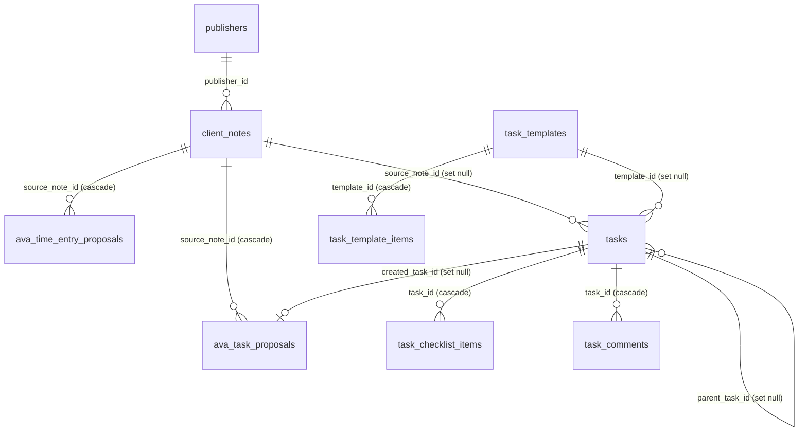

# DATA-MODEL — Supabase Postgres

System of record: **Supabase Postgres, project `slpdibnxtpdlttbbczvg`, region `ap-southeast-2` (Sydney), Postgres 17.**
Verified live 2026-08-27: **78 tables in `public`, RLS enabled on all 78.**

Xano is still read by the remaining §3/§4 PORT files in `XANO-SEVERANCE-REGISTER.md`. XS-2a removed the finance HTTP (`xanoFinanceApi` deleted, `xanoReferenceCache`, `readFinance`, xero-queue, relevant plan versions, forecast dataset). XS-1 removed the Postgres-then-Xano mirror writes. Table and column names that still say "xano" (`MART.XANO_LINE_ITEMS_SNAPSHOT`, `xano-line-item-sync`) are frozen contract names — do not rename them.

## How the app reaches the database

| Path | Used by | Notes |
|---|---|---|
| `db/index.ts` → `getDb()` (Drizzle, pooler port 6543, `prepare:false`) | Everything normal | Lazy proxy; `server-only`; `DATABASE_URL` |
| `sql` tagged templates through the same `getDb()` | Finance periods and runs, notifications, Xero matching, working drafts, plan presence | These tables **are** mirrored in `db/schema/` (as of `536f0476`) but their callers still use raw SQL. Migrating them to the query builder is a separate decision |
| `db/avaClient.ts` → `AVA_DATABASE_URL` as role `ava_readonly` | AVA only | Fail-closed; explicit per-table `GRANT SELECT` + `CREATE POLICY ava_read`. New tables are excluded by default |
| `DIRECT_URL` (port 5432) | `drizzle-kit` only | Never at runtime |

**Migrations are applied by hand** through the Supabase SQL editor from `db/migrations/00NN_*.sql` (50 applied, `0001`…`0050`; there is no `0047` — the number was minted and abandoned). `0055_line_item_panels_unique.sql` is applied. `0051_finance_billing_records_backfill.sql`, `0052_xero_billing_amounts_ex_gst.sql`, `0053_client_billing_lifecycle.sql`, `0058_planning_uploaded_audiences.sql`, `0059_publisher_profile_audit.sql`, `0060_publisher_value_synonyms.sql`, `0061_publisher_profile_field_defaults.sql`, `0062_publisher_profiles_jcd_bought_rate.sql`, `0063_delivery_source_map.sql`, `0064_plan_presence.sql`, `0066_publisher_profiles_money_rules.sql`, `0074_delivery_source_map_channel_factory.sql`, `0075_delivery_source_map_twitch.sql`, `0077_delivery_source_map_prog_ooh.sql`, `0079_campaign_reads.sql`, `0080_campaign_kpi_target_source.sql`, `0081_pacing_portfolio_snapshots.sql`, `0082_campaign_reads_generating.sql`, `0083_campaign_kpi_dedupe.sql`, `0084_pacing_scenarios.sql`, `0085_delivery_relabels.sql`, and `0086_relabel_drift_snapshots.sql` are authored, not applied. `0065_backfill_published_at_on_pointers.sql` is the record of the live 5 Sep 2026 stamp (`published_at = created_at` on 34 published pointers; `published_by` left NULL; no schema change; re-run is a marker no-op). `0069_published_pointer_must_be_stamped.sql` (VP-1 deferred constraint triggers) and `0070_backfill_vp1_unstamped_pointers.sql` (exactly 12 C-113 rows; `published_at = created_at`, `published_by = backfill:vp-1`) are authored, not applied. `0071_clear_plan_working_drafts.sql` deletes the nine live working-draft rows by master_id (no `campaign_status` update) and is authored, not applied. Required order: R1 live in production, then 0070, then 0069. 0069 does not validate existing rows, so 0070 stamps first. Do not apply 0069 until the stamping writer is live. `db/schema/*.ts` is a hand-kept Drizzle mirror covering all 78 tables (0058 adds two more once applied; 0059 adds `publisher_profile_changes` + `publisher_profiles.updated_by`; 0060 adds `publisher_value_synonyms`; 0061 adds `publisher_profiles.field_defaults`; 0062 merges one JCDecaux `column_map` key and does not change schema; 0063 adds `delivery_source_map`; 0064 adds `plan_presence`; 0066 adds `publisher_profiles.money_rules`). Do not `db:migrate` the drizzle baseline — the tables already exist. Do not promote the 0059 / 0060 / 0061 / 0063 / 0064 / 0066 Drizzle mirrors before applying those migrations (C-76). Do not SELECT `delivery_source_map` until 0063 is applied — runtime is `lib/delivery/deliverySourceMap.ts`. Do not SELECT `plan_presence` until 0064 is applied — runtime is raw `sql` and fail-softs. Do not SELECT `money_rules` until 0066 is applied — `listPublisherProfiles` falls back to seed.

**`db:generate` does not prove the mirror matches the database.** The baseline was regenerated from the TypeScript mirrors, so an empty diff proves only that nobody edited `db/schema/*.ts` without regenerating the snapshot. It compares code to its own snapshot, not code to Postgres. Two columns were missing from the mirror while `db:generate` was clean.

**The real gate is `npm run db:drift`** — a comparison against `information_schema`. Run it before any handover that touches the schema. Never apply the file `generate` produces.

`0092_revoke_published_pointer_fn_execute.sql` revokes EXECUTE on `public.enforce_published_pointer_stamped()` from public, anon and authenticated. The function is a trigger (`RETURNS trigger`). Triggers still fire. Applied. No Drizzle change.

**Backfill rule.** Any migration that backfills existing rows must be guarded by a `migration_markers` key. `WHERE col IS NULL` alone is not a re-run guard: once the feature is live, NULL means a genuine unfilled state and a re-run corrupts it.

### Postgres enum types (9)

`line_channel` (20 values) · `schedule_component` (media, fee, adserving) · `schedule_basis` (billing, delivery) · `schedule_source` (computed, override) · `finance_period_status` (open, pre_run_review, run, review, locked, invoiced, reconciled) · `finance_run_item_status` (pending, approved, adjusted, held, excluded, stale) · `finance_run_source` (media, retainer, sow) · `xero_match_method` (reference, heuristic, manual) · `xero_match_status` (matched, diverged, disputed, written_off)

All declared in `db/schema/enums.ts`. Value order is part of the type — appending is safe, reordering is not.

## The three universal keys

| Key | Shape | Spans |
|---|---|---|
| `mba_number` | text business key, e.g. `PENFOLD016` | masters, versions, line approvals, billing, KPI, panels, insights, campaign reads, tasks, time entries, Xero matches, Snowflake |
| `version_id` / `version_number` | `media_plan_versions.id` (FK) and its ordinal | line items, schedule months, fee snapshots, billing overrides |
| `line_item_id` | `<MBA><CODE><n>`, e.g. `PENFOLD001SE1` — built by `lib/mediaplan/lineItemIds.ts` | plan lines → Snowflake delivery facts → KPI fan-out → billing bursts → trafficking names → OOH panels |

| `line_item_id` is a **text join key with no foreign key behind it** in several places (`line_item_panels`, `campaign_kpi`, `schedule_months`, `mba_line_approvals`). That is intentional — panels and KPI predate consolidation — but it means the database will not stop you writing an orphan. Validate in the lib layer. Ingest panels are uniquely keyed `(line_item_id, source_row_ref) WHERE source_row_ref IS NOT NULL` (`0055` applied) — pack rows share a line id; hand-created panels with null `source_row_ref` are not constrained.

Two frozen contracts: the **`bursts` jsonb shape** (`serializeBurstsJson.ts` / `formatBurstsForPersist.ts`) and the **`line_item_id` format**. Pacing, billing, finance, dashboards, exports and the Snowflake sync all parse them. Change every consumer or none.

Case traps that are enforced by the database: `campaign_insights.mba_number` and `line_item_panels.mba_number` have `CHECK (col = lower(col))`. Do not add app-side casing that fights them. `media_plan_masters.mba_number` is mixed-case in production (~36% of the book); in-memory joins use `mbaJoinKey` and must not lowercase stored or displayed values.

## Plan core

| Table | Rows (live) | Key columns | Notes |
|---|---|---|---|
| `media_plan_masters` | 192 | `mba_number` UNIQUE, `client_id`→clients, `published_version_id`→versions, `campaign_budget_cents`, index `idx_media_plan_masters_published_version_id` | **`published_version_id` is the publication pointer.** Never infer the published version from `max(version_number)` or from `campaign_status`. **VP-1 (0069 AUTHOR ONLY):** pointer must be NULL or reference a version with `published_at` set (deferred constraint triggers; 0070 stamps the 12 C-113 rows first because CREATE CONSTRAINT TRIGGER does not scan existing rows). Required order: R1 live, then 0070, then 0069. Readers: `publishedVersionIdFromMaster` / `PUBLISHED_VERSION_JOIN_SQL` (pointer AND stamp). **0072 AUTHOR ONLY:** btree on `published_version_id` covering `fk_masters_published_version` (unindexed FK; finance joins, guard fragment, 0069 reverse lookup). Table is small (~189 pointers); plain `CREATE INDEX`, not `CONCURRENTLY`. |
| `media_plan_versions` | 1,089 | UNIQUE(`master_id`,`version_number`), `published_at`, `published_by`, `approved_slice` jsonb, `mba_scope` jsonb, `snapshot_checksum`, `mi_resolution` jsonb, `channel_flags`, `legacy_schedules`, `mba_pdf_file` / `media_plan_file` / `aa_media_plan_file` jsonb | `published_at` NULL = unpublished. `published_by` is a lowercase email, NULL, or the VP-1 sentinel `backfill:vp-1` (0070 AUTHOR ONLY; 0018 CHECK). Never an Auth0 `sub` — the CHECK is lowercase-only and would accept `auth0|…`. Production R1 does not reset `created_at` when stamping (C-114). `approved_slice` is the frozen billing law at publish — **never mutate after write**. `mba_scope` is `{ lineItemIds, monthYears, partial }`; **null = full scope** (0076 AUTHOR ONLY; no backfill). File jsonb shapes: Blob `{ url, pathname, name, size, mime, uploadedAt, source: "vercel-blob" }` (upload); regenerated `{ …, source: "regenerated", generatedFrom: "persisted" | "explode" }`; ETL Xano Public File `{ path, name, mime }`; XS-3 copy `{ url, mime, name, size, source: "migrated_from_xano", pathname, xano_url }` (old vault url kept on the object for rollback; script `scripts/migration/xs3-vault-to-blob.ts`, marker `xs3_vault_to_blob` only after a complete zero-failure run). File pointers may be written after publish; regenerate never mutates plan content. `savePlanVersion` draft overwrite omits these columns when the save payload does not send them (DOC-1b) |
| `line_items` | 16,590 | UNIQUE(`version_id`,`line_item_id`), `channel` enum, `bursts` jsonb, `attrs` jsonb | One table replaces 20 per-channel tables. Common columns are typed; the channel-specific tail lives in `attrs`, validated per channel by zod in `db/schema/lineItemAttrs.ts` (`.passthrough()` for legacy keys) |
| `schedule_months` | 59,324 | UNIQUE(`version_id`,`line_item_id`,`component`,`basis`,`month`), `amount_cents` | The billing and delivery schedule as **rows**, not JSON blobs. `component` = media\|fee\|adserving · `basis` = billing\|delivery · `source` = computed\|override |
| `mba_fee_snapshots` | 74 | `version_id` UNIQUE, `fees` jsonb | Fee state captured at publish |
| `billing_overrides` | 1 | UNIQUE(`version_id`,`line_item_id`,`component`) | Recorded manual overrides — who, when, value. Never inferred from drift |
| `mba_line_approvals` | 0 | UNIQUE(`mba_number`,`media_plan_version`,`line_item_id`,`media_type`) | **Absence of a row means approved.** Postgres-authoritative; skipped by ETL |
| `plan_working_drafts` | 10 | UNIQUE(`master_id`,`user_id`), `base_version_id` | Autosave, one row per editor. Identity is email else `sub` — never `"unknown"`. Flag `NEXT_PUBLIC_PLAN_DRAFTS`; off does not delete rows. Callers use raw `sql`. **Interim `SAVE_PUBLISHES_IMMEDIATELY`:** save no longer writes these as the save path; Edit offers a matching-base row and applies it only on Restore (Create still auto-restores); the row still clears on save. **0071 AUTHOR ONLY** deletes eight of these at go-live (no `campaign_status` change) and keeps STRMEA001 (267) and glenda009 (10012553); recovery `exports/working-drafts/plan_working_drafts-2026-09-14T005310965Z.json` |
| `plan_presence` | 0 (0064 not applied) | PK(`master_id`,`user_id`), `page` (`edit`\|`create`), `last_seen_at` | Who else has the campaign open. Identity from `draftIdentity` (email else `sub`) — never `"unknown"`. GET returns others with `last_seen_at` within 90s. Not a lock. RLS on; no `ava_readonly`. Callers use raw `sql` and fail-soft. Do not SELECT until applied (C-76) |

**Channel enum** (`line_channel`, 20 values): `television radio cinema newspaper magazines ooh prog_display prog_video prog_audio prog_bvod prog_ooh digi_display digi_video digi_audio digi_bvod social search influencers integrations production`

**Bursts field name quirk:** `cinema`, `radio` and `production` carry bursts under `bursts`; every other channel used `bursts_json`. The consolidated column is always `bursts`; `lib/data/planShapes.ts` (`BURSTS_FIELD_AS_BURSTS`) re-splits it on the way back out to legacy consumers.

## Clients and publishers

| Table | Rows | Notes |
|---|---|---|
| `clients` | 46 | ~90 columns. `slug` (unique on `lower(btrim())`) is tenant identity. `mbaidentifier` seeds MBA numbers. Per-channel `fee*` and `adserv*` rates. `client_brain` text + `client_brain_updated_at`. `m365_is_anchor` partial-unique per `mbaidentifier` group. `client_name_aliases` jsonb for Fireflies title matching |
| `client_domains` | 56 | email domain → client, for meeting attribution |
| `clientdashboard` | 1 | per-platform dashboard ids |
| `publishers` | 77 | ~100 columns: `pub_*` channel flags, `*_comms` commission rates, per-family CPM/CPC/CPV/CTR/VTR/frequency defaults, `best_practice` jsonb, `publisher_colour` |
| `publisher_profiles` | 4 | Schedule-ingest parsing config. `detect_signature`, `column_map` (header→field; 0062 AUTHOR ONLY jsonb-merges JCDecaux `MEDIA BOUGHT RATE` → `media_rate:bought` without rewriting the rest of that row), `field_defaults` (canonical field→one value for every line; 0061 AUTHOR ONLY), `money_rules` (media amount basis + stated-cell / section / rate-card labels; 0066 AUTHOR ONLY — not `sheet_rules`), `grid_semantics` (status_matrix\|count\|currency), `line_granularity` (per_row\|grouped), `legend_map`, `sheet_rules` — all jsonb on the row, not TypeScript. `updated_by` (0059 AUTHOR ONLY) is the last accepted remap identity. Value-level prose → AV canonical lives in `publisher_value_synonyms`, not on this row |
| `publisher_profile_changes` | 0 (0059 not applied) | Audit of accepted `column_map` and `field_defaults` writes: `header` (column name or field id), `previous_value` / `next_value` (null = key absent / removed), `action` (`map`\|`remap`\|`remove`), `changed_by`, `source` (`ava_card`\|`hub_remap`\|`admin`\|`model_proposed`), optional `stage_id`. Same txn as the profile update. RLS on; no `ava_readonly` grant |
| `publisher_value_synonyms` | 0 (0060 not applied) | Learned publisher prose → AV canonical. `publisher_id` NULL = global suggestion tier (never auto-applied). Unique active scope `(coalesce(publisher_id,0), vocabulary, raw_value)`. Seed nothing — every row is a human value-card answer. RLS on; no `ava_readonly` grant |
| `delivery_source_map` | 0 (0063 not applied) | Programmatic `publisher_key` → `dsp` \| `cm360` \| `partner_file`. PK is the lowercased platform/publisher string. Seed = today's DV360/Taboola allowlist plus both Quantcast keys (`quantcast` and `quantcast - direct`) plus `channel factory` → `partner_file` (`0074`) plus `twitch` → `cm360` / `derive_spend_from_plan` true (`0075`) plus `vistar` / `broadsign` → `partner_file` (`0077` AUTHOR ONLY; app still reads the TS seed, C-76). `derive_spend_from_plan` drives modelled delivered spend on programmatic cm360 lines (`lib/delivery/deriveSpendFromPlanRate.ts`); DSP, Channel Factory, and Vistar/Broadsign stay false. Runtime lookup is the TypeScript seed until applied. RLS on; no `ava_readonly` grant |
| `publisher_specs` / `spec_runs` | 20 / 0 | Material specs and deadline days. Joined on `publishers.id`, never on display name |
| `spec_deadline_overrides` | 0 | Explicit manual deadline override: who, when, value |
| `publisher_domains` | 1 | Learned on manual Fireflies assign. **Never seed vendor domains** |
| `ingest_stages` → `ingest_runs` → `ingest_eval_runs` | 0 / 0 / 0 (0067 not applied) | Staged review package (uuid `stage_id`, `expires_at` NULL = retained; `review_package` jsonb includes nested `line_audit` + `parse_review`; `source_file` jsonb is the private Blob pointer, 0068 AUTHOR ONLY, null when retain failed). Accepted-run history, then weekly parser-accuracy rows (one per publisher). Do not SELECT `source_file` / `ingest_eval_runs` until 0068 / 0067 are applied (C-76) |
| `line_item_panels` / `line_item_panel_flights` | 0 / 0 | OOH panel and pack detail + per-period presence. **No money columns** — spend stays on the burst. `buy_granularity` panel (1:1) or pack (1:N). Partial unique `(line_item_id, source_row_ref) WHERE source_row_ref IS NOT NULL` (`0055` applied) |

## Media reference (dropdown data)

`tv_stations` (7) · `radio_stations` (56) · `newspapers` (20) · `newspaper_adsizes` (6) · `magazines` (6) · `magazines_adsizes` (1) · `audio_site` (9) · `bvod_site` (6) · `display_site` (36) · `video_site` (12) · `media_container_best_practice` (12, jsonb per container, edited at `/admin/media-container-best-practice`)

## KPI

Three tiers, most specific wins.

`campaign_kpi` (9,732) keyed by `lower(mba_number)` + `version_number` + `lower(line_item_id)` → `client_kpi` (0) keyed by `mp_client_name` → `publisher_kpi` (901) keyed by publisher + `bid_strategy` + `media_type`. Writes upsert on that key (`lib/data/writeKpi.ts`); unique index `uq_campaign_kpi_mba_version_line` is 0083 AUTHOR ONLY (dedupes twins, keep newest `created_at` then max `id`). `campaign_kpi.target_source` (`target` \| `benchmark`, default `target`) and `benchmark_ref` are 0080 AUTHOR ONLY — do not SELECT until applied (C-76). Existing rows are `target`. Industry fill is `scripts/kpi/backfill-benchmarks.mjs` (empty/all-zero or missing rows on published live/booked/approved plans only; fail-closed if 0080 is missing or if twins exist for a plan it is about to touch).

Metrics on all three: `ctr`, `cpv`, `conversion_rate`, `vtr`, `frequency`. Campaign writes keep `cpv` null (column stays; leftover values are ignored by the MBA review). `client_kpi` is currently empty — the cascade falls through it to publisher defaults.

## Finance

| Table | Rows | Notes |
|---|---|---|
| `finance_periods` | 0 | Month status via `finance_period_status`, `amended_after_lock`, sheet blob pointer. Unique on `period_month` |
| `billing_partner_packs` | 0 (0100 applied) | One Advertising Associates send for a billing month. `billing_month` is the first of the month. `status` is `draft` or `sent`. `created_by` is required. `sent_at` / `sent_by` / `blob_pathname` / `note` are null until send. Index `(billing_month, status)`. RLS on, no policies, no `ava_readonly` grant. |
| `billing_partner_pack_items` | 0 (0100 applied) | Versions in a pack. `pack_id` → `billing_partner_packs.id` on delete cascade. `version_id` → `media_plan_versions.id`. Unique `(pack_id, version_id)`. `change_kind` is `new` or `amended`. `months_changed` jsonb is null when either side has no `schedule_months`. `back_dated` defaults false. Indexes on `mba_number` and `version_id`. RLS on, no policies, no `ava_readonly` grant. |
| `finance_run_items` | 0 | The billing run. Five FKs: `period_id`→periods (cascade), `client_id`→clients, `version_id`→versions, plus self-references `linked_variance_from_item_id` and `rolled_from_item_id`. `sow_id` has **no** FK. Unique on (period_id, source, natural_key) |
| `finance_billing_records` | 480 | `invoice_key` UNIQUE, `billed_amount_cents`, `billed_lines_hash`. Lifecycle stamps: `approved_at` / `approved_by` / `approved_by_name` + amount/hash snapshot, `exported_at` / `exported_by` / `export_blob_path` (JSON `{"csv","xlsx"}` pathnames, `0089`, written by `POST /api/finance/send-to-accounts`; mark-exported and unmark-exported return 410), `matched_xero_invoice_id` / `matched_at` / `matched_by` (`auto`\|`manual`), `xero_match_resolution` (`auto_adopted`\|`differs`\|`adopted`\|`disputed`), `xero_expected_source` (`approved_snapshot`\|`schedule_month`\|`legacy_billed`). The match index is non-unique (`0088`; many app rows may share one Xero invoice). State is derived (`resolveBillingState`) — no `state` column. PATCH-by-id refuses `billed` / `billed_at` / `billed_by` / `total` / billed snapshot / lifecycle stamps (`FIELD_NOT_ALLOWED`). `matched_xero_invoice_id` is `xero_ar_invoices.xero_invoice_id` text, no FK. App writes via `writeFinance.ts` (never `xero:`); Xero ingest owns `xero:` keys and stores `sub_total` (ex-GST), not Xero Total. **Postgres-authoritative** with `finance_billing_line_items` — `db:etl` must not truncate-reload (C-85). `0053` AUTHOR ONLY |
| `finance_billing_line_items` | 1 | child of records; `line_status`, `received_amount`. Postgres-authoritative with parent (C-85) |
| `finance_edits` | 677 | before/after audit of billing edits. App audit inserts via `writeFinanceAuditEdits` (Postgres). `POST /api/finance/edits` still Xano |
| `finance_forecast_snapshots` / `_lines` | 0 / 0 | Immutable snapshots, hash-deduped, cascade delete |
| `revenue_forecast_lines` | 0 | UNIQUE(`clients_id`,`fy`,`line_key`,`month`) |
| `revenue_line_catalog` | 10 | `line_key` UNIQUE, `fee_pct`, `booked_mapping` |
| `finance_saved_views` | 0 | note: column is `user_id` (`user` is reserved) |
| `finance_clearance_sends` | 0 | `0090` applied. `month`, `sent_at`, `hash` (sha256 of the sorted invoice id / state / amount list), `counts` jsonb `{cleared, differs, missing}`. Written only after the clearance email succeeds. |
| `billing_revisions` | applied (0106, 26 Oct 2026) | Billing revisions audit. One row per billing timing change on a published plan: `master_id`, `mba_number`, `base_version_id`/`_number`, `new_version_id`/`_number` (NULL for a credit note), `mode` (pull_month, bill_remainder, bill_amount, underspend, restore; 0109 adds true_up and true_up_restore), `params`, `reason` (required), `moved_cents`, `diff` (changed cells, credits, warnings, undo target), `result_hash`, `source` ui/ava, `created_by` (team_members.id, no FK), `restores_revision_id`, `status` applied/restored/noted. RLS on, no ava grant. Written only by `publishBillingRevision`. |
| `client_finance_owners` | applied (0105) | FP-6. One finance owner per client: `client_id` PK → `clients`, `team_member_id` → `team_members` (set null on delete). No row = no owner. Edited on `/finance/owners` (admin). Read by the To bill client cards. 0109 adds `billing_timing` (`same_month` \| `month_ahead` \| `in_arrears`, null = same month): the true-up moves an invoice issued in month M to M+1 (month ahead) or M-1 (in arrears) unless finance assigned it by hand. Do not read it before marker `0109_true_up`. |
| `true_up_runs` | not applied (0109 authored) | Monthly true-up runs: `as_of_month`, `from_month` (first of month), `source` cron/manual, `created_by`/`_name`, `xero_synced_at`, `provisional_invoices`, `mbas_needing_action`, `totals` and `rows` (the computed report, jsonb), `emailed_at`. Written by `lib/finance/trueUp/runs.ts` (cron on the 2nd, or Run now). RLS on, no ava grant. |
| `true_up_actions` | not applied (0109 authored) | True-up ledger, one row per MBA and component: `action` schedule (a billing revision of kind true_up, `billing_revision_id`, `strategy` spread/carry, `months` trued up) \| explained (`reason_code`, `note`) \| one_off (a charge or credit to raise, `amount_cents`) \| credit_note (`xero_invoice_id`). `gap_cents` and `amount_cents` are signed: + credit to the client, - charge. `status` applied/undone. RLS on, no ava grant. |
| `true_up_invoice_links` | not applied (0109 authored) | Hand links from a Xero invoice to an MBA (`xero_invoice_id` unique, `mba_number`, optional `billing_month`) for invoices the true-up can't attribute (golf012 to golf025, INV-1413 to jayco017). Wins over every other attribution. RLS on, no ava grant. |
| `overdue_digest_sends` | 0 | `0093` applied (Supabase, 9 Oct 2026, by Claude). Primary key `as_of_date` (Sydney civil date). `sent_at`, `invoice_count`, `total_due_cents`, `recipients` text[]. Written only after the weekday overdue digest email succeeds. RLS on, no policies. |
| `app_notifications` | 902 | Cross-cutting anomaly log, keyed by `audience` + `kind`. Partial index on unread. Dominated by `billing_overrides_publish_carry` (884) |

`fy` means the Australian financial year **ending** year. AVA speaks AUD.

## Xero

`xero_ar_invoices` (1,433) · `xero_ap_bills` (2,180) · `xero_contacts` (223) · `xero_sync_exceptions` (1,381; `0091` applied: `resolved_at`, `resolved_by`, `resolution`) · `xero_sync_log` (12) · `xero_client_aliases` (0, manual normalised-name → `clients.id`) · `xero_contact_links` (0 until `0054_seed_xero_contact_links` is applied; AR identity keys on `xero_contacts.xero_contact_id`; PC6 reassign still writes normalised-name keys) · `xero_invoice_matches` (0, → `finance_run_items`) · `xero_match_month_metrics` (0)

All nine are **postgres-authoritative**: `db:etl` must not truncate-reload them (`POSTGRES_AUTHORITATIVE_TABLES` in `scripts/migration/_etlTables.ts`). Recon reports Xano vs Supabase counts but never fails on mismatch. The five ingest tables (`xero_ar_invoices`, `xero_ap_bills`, `xero_contacts`, `xero_sync_exceptions`, `xero_sync_log`) still have a 10 Jul Xano snapshot twin — that snapshot is stale; live state is written by `lib/xero/**`. The matcher/alias four (`xero_invoice_matches`, `xero_match_month_metrics`, `xero_contact_links`, `xero_client_aliases`) have no Xano twin.

The last three are mirrored but their callers use raw `sql`. Sync is four crons from 00:15 UTC (invoices, import, contacts, pdfs), 15 minutes apart. Each writes a `running` `xero_sync_log` row first and updates it. `stage` and `duration_ms` are migration `0087` (apply before deploy; no backfill). Resume uses the newest success or incomplete row for that stage, skipping `running` and `failed`. Ops-health "Xero sync freshness" is red when any stage's newest success is missing or older than 36 hours. `stage` values `backfill-invoices` / `backfill-contacts` / `backfill-rematch` / `backfill-pdfs` / `backfill-sql` are the local `scripts/xero-backfill.ts` script only; cron watermark and ops-health freshness stay the four cron stage names. The pdfs backfill selects `issue_date >= 2025-07-01` rows (no FY end cap) with `pdf_file IS NULL OR pdf_file->>'url' IS NULL OR pdf_file->>'url' = ''` (Xano stubs in scope), `head`s the target blob before Xero, writes `{url, pathname, filename, size, uploadedAt}` on a hit, and `put`s a miss with `addRandomSuffix: false` and never `allowOverwrite`. Day budget 4000, batch 10, two-minute pause. The update matches that same pending predicate; a zero-row update is `unstored`. Log notes report `stored`, `reused`, `fetched`, `unstored`, and `still_missing`; the step is `incomplete` while `still_missing` is above zero. AR `mba_number` is filled from the Xero Reference by `matchMba.ts` (MBA token, then `scope_of_work.scope_id`); a scope hit does not write `mba_number`. `pdf_file` is Blob-backed `{url, pathname, filename}` on success; ETL left a non-null Xano stub with no `url` key. `sync_pdfs` pending = `IS NULL OR NOT (pdf_file ? 'url')`, FY26+, batch 10 (`XERO_PDF_BATCH_SIZE`), 40s budget.

## Codex — tasks, meetings, time

| Table | Rows | Notes |
|---|---|---|
| `client_notes` | 131 | Fireflies meetings. `fireflies_meeting_id` UNIQUE. `attributed_type` = client\|publisher\|internal\|new_business; **NULL is the unattributed queue**. `matched_by` records how attribution happened |
| `tasks` | 46 | `client_id` has **no FK** to `clients` (deliberate, from the ETL era). `auto_created` + `ava_auto_key` for unique-roster auto-create. Soft delete via `deleted_at`. Help children: `parent_task_id` bigint → `tasks(id)` ON DELETE SET NULL, plus `help_requested_by_email` / `help_prior_status` (0078 applied) |
| `team_members` | 11 | `email` UNIQUE and `auth0_user_id` UNIQUE — identity is email, never a numeric id. `email_aliases`, `default_client_ids` array. Synced by `auth0-roster-sync` |
| `ava_task_proposals` | 1,352 | proposed → accepted / accepted_edited / rejected / expired, with `decision_diff` for learning |
| `ava_time_entry_proposals` | 26 | UNIQUE(`source_note_id`,`member_email`); blocked_overlap / blocked_structure states |
| `assignment_rules` | 0 | partial unique on `COALESCE(client_id,0)` + category where active |
| `codex_activity` | 797 | entity/action audit log |
| `fireflies_sync_state` | 3 | run log |
| `meeting_title_rules` | 0 | exact match on normalised title |
| `time_entries` / `myhours_links` / `myhours_sync_runs` | 0 / 0 / 0 | MyHours mirror is pull-source-of-truth; the Confirm path is the only intentional write back |

## Everything else

| Table | Rows | Notes |
|---|---|---|
| `creative_asset` | 22 | Row + Vercel Blob file; `blob_url` / `blob_pathname` |
| `scope_of_work` | 9 | jsonb `cost` and `billing_schedule` |
| `planning_audiences` | 1 | saved audience definitions, `client_visible` flag; `definition_json` additive upload provenance (`source` + file/wave/filter) |
| `planning_audience_uploads` | 0 (0058 not applied) | staged Roy Morgan workbook parse (`parse_json` jsonb); 48h TTL (`expires_at` NULL = retained); `blob_url` stores a private Blob pathname, never a public URL |
| `planning_uploaded_audiences` | 0 (0058 not applied) | saved uploaded audiences; `segment_key` = `upl_<id>` (`AudienceDraft.segmentId`); `channels_json` is server-mapped `RmMappedChannel[]`; rebuild uses `audience_wc` / `unweighted_n` / `universe_wc` / `suppressed_cells` on the row, not parent `parse_json` |
| `campaign_insights` | 0 | Append and supersede (`superseded_by` self-FK, paired with `superseded_at` by CHECK). **Never delete.** GIN full-text index on `body`. `mba_number` lowercase by CHECK. `insight_type` stays the category (delivery / audience / creative / channel / commercial). `action`, `action_owner`, `outcome` and `outcome_kind` are nullable text (0094 applied, Supabase, 9 Oct 2026, by Claude). `outcome_kind` is null, `achieved`, or `expected`. |
| `campaign_reads` | 0 (0079/0082 not applied) | Dashboard six-beat campaign read. One row per generation. `status` draft\|published\|generating\|failed. `error_message` is set on failed. Publish unpublishes earlier published rows for the same mba+version. `body_markdown` is derived from `beats`. RLS on; no `ava_readonly` grant. Do not SELECT until 0079+0082 are applied (C-76) |
| `pacing_portfolio_snapshots` | 0 (0081 not applied) | Daily campaign-level portfolio. Unique `(as_of_date, scope_key, live_only)`. `scope_key` is `pacingScopeKey` (`all` or sorted slugs). `rows` / `counts` jsonb. Served by `GET /api/pacing/portfolio`; written by `/api/cron/pacing-portfolio` and admin miss/refresh. RLS on; no `ava_readonly` grant. Do not SELECT until 0081 is applied (C-76) |
| `pacing_scenarios` | 0 (0084 not applied) | Saved scenario planner runs. `mba_number`, `version_number`, `name`, `levers` jsonb, `result` jsonb, `created_by_email`. Index `(mba_number, created_at desc)`. Served by `GET|POST /api/pacing/scenarios`. RLS on; no `ava_readonly` grant. Do not SELECT until 0084 is applied (C-76) |
| `delivery_relabels` | 0 (0085 not applied) | Delivery relabel apply/revert/block audit. `channel`, `platform_entity_id`, `entity_name`, from/to `line_item_id`, `mba_number`, optional date window, `reason`, `actor_email`, `status` applied\|reverted\|blocked, `before_state` jsonb, `apply_result` jsonb. Indexes `(mba_number, created_at desc)` and `(channel, platform_entity_id, created_at desc)`. Written by `lib/pacing/relabel`. RLS on; no `ava_readonly` grant. Do not SELECT until 0085 is applied (C-76) |
| `delivery_relabel_log` | 0 (0085 not applied) | Per-action payload for `delivery_relabels` (`action` preview\|apply\|warn_ack\|block\|revert, `payload` jsonb). FK `relabel_id` nullable for preview. RLS on; no `ava_readonly` grant. Do not SELECT until 0085 is applied (C-76) |
| `relabel_drift_snapshots` | 0 (0086 not applied) | Nightly LABEL_MAP vs applied `delivery_relabels`. Unique `as_of_date`. `findings` jsonb; `legacy_count` / `drift_count`. Written by `/api/cron/relabel-drift`; read by the 7am digest and the relabels Log tab. RLS on; no `ava_readonly` grant. Do not SELECT until 0086 is applied (C-76) |
| `pacing_orphan_fixes` | 1 | admin reassignment audit for unmatched platform line items |
| `m365_provisioning_log` | 0 | every Graph provisioning attempt: success / failure / skipped |
| `migration_markers` | 5 | backfill guards |
| `view_as_audit` | not applied (0108 authored) | View as client audit. `action` `start`\|`exit`\|`expire`\|`blocked_write`; `admin_sub` / `admin_email` are the real admin; `client_id`, `client_slug`, `as_user_id` (null, Mode 2 not built), `path`, `method`, `duration_minutes` (30, 60 or 120 on start), `user_agent`. Indexes `(created_at desc)`, `(client_slug, created_at desc)`. RLS on, no policies, no `ava_readonly` grant. Raw SQL writer `lib/auth/viewAsAudit.ts`; mirror `db/schema/viewAsAudit.ts`. Start refuses until it exists |
| `report_runs` | 0 | `0095` applied (Supabase, 9 Oct 2026, by Claude). One campaign report run. `id` uuid. `kind` defaults to `monthly_campaign`. `mba_number`, nullable `client_id` → `clients.id` (bigint). `period_start` and `period_end` are dates. `status` is queued, generating, generated, failed or skipped. Index `(kind, period_start, status)`. `commentary_generated` is nullable. `0097` is applied. `requested_by_email` is who asked for an `on_demand_deck`; monthly rows leave it null. `uq_report_runs_kind_mba_period` is a partial unique index `WHERE kind <> 'on_demand_deck'`. `0099` is authored and not applied. `detail_level` is `channel`, `line_item` or `ad_group`, default `channel`. Do not SELECT it until 0099 is applied (C-76). Once applied, `uq_report_runs_on_demand_inflight` is unique on `(kind, mba_number, period_start, detail_level)` `WHERE kind = 'on_demand_deck' AND status IN ('queued', 'generating')`. Until then the applied 0097 index is `(kind, mba_number, period_start)` with that same predicate. RLS on, no policies. `GET /api/cron/reports-enqueue` inserts `queued` rows on the 4th and 5th Sydney when `AUTO_REPORTS_ENABLED` is `true`. The cron and admin inserts are `on conflict do nothing` on `(kind, mba_number, period_start)` where `kind <> 'on_demand_deck'`. `GET /api/cron/reports-worker` claims queued or failed rows (`attempts` under 3, `kind <> 'on_demand_deck'`) on the Sydney 4th and 5th, up to `REPORTS_WORKER_BATCH` (default 3), and writes generated, skipped or failed. A row left in `generating` for more than 30 minutes returns to queued, or fails with `timed out 3 times` at 3 attempts, and that reset skips `on_demand_deck`. `POST /api/reports/on-demand` inserts `on_demand_deck` as queued and returns `{ runId, status }`. The deck runs in `after()`. A deck note is stored in `error` prefixed `note:` because there is no note column. `GET /api/reports/on-demand/[runId]` returns status for an MBA the caller can see. `GET /api/cron/on-demand-decks` every 5 minutes claims one row queued for more than 2 minutes and fails rows generating for more than 10 minutes with `Timed out`. `/admin/reports` reads a month. `POST /api/admin/reports/runs/[id]/generate` writes that row. `POST /api/admin/reports/enqueue` inserts missing queued rows for the chosen month and does not generate. |
| `report_digest_sends` | 0 | `0095` applied (Supabase, 9 Oct 2026, by Claude). One digest email per kind and period. Primary key `(kind, period_start)`. `recipients` text[], `run_count`, `sent_at`. RLS on, no policies. The reports worker sends one internal email when that period has rows and nothing is queued or generating, or from 16:00 Sydney on the 5th. Zero rows never send. `REPORTS_EMAIL_TO` overrides the ops list. Kind `billing_partner_reminder` uses `period_start` as the Melbourne civil date of an AA pack reminder, not a report period. |
| `client_platform_accounts` | `0096` applied | More than one account per platform. `client_id` → `clients.id`. `platform` is `meta_ads`, `google_ads`, `cm360`, `dv360`, `tiktok`, `reddit`, `taboola`, `vistar`, `channel_factory`, `linkedin`, `pinterest`, `snapchat`, `ga4` or `gsc` (`0098` applied). `account_ref` is digits for the numeric platforms, GA4 property-id digits, the Fivetran SITE string for Search Console, and the advertiser name for CM360 and DV360. Partial unique `(platform, lower(account_ref)) WHERE active`. Index on `client_id`. `clients.idmeta` stays the Meta page id. RLS on, no policies, no `ava_readonly` grant. Do not SELECT until 0096 is applied (C-76). Do not rely on `ga4` or `gsc` until 0098 is applied. The client routes return 503 until the table exists. `GET /api/platform-accounts/advertisers` reads `V_PLATFORM_ADVERTISERS` and returns 503 until that view exists. The client page lists GA4 and Search Console only when `NEXT_PUBLIC_PLATFORM_ACCOUNTS_WEB` is `1` |
| `creative_preview_cache` | 0 (`0098` applied; `0102` not applied) | Creative preview cache. `platform` is `meta`, `tiktok` or `cm360`. `creative_key` is a Meta ad id, a TikTok ad id, or a normalised CM360 creative name. Unique `(platform, creative_key)`. Nullable `client_id` → `clients.id`: the one client every MBA the creative delivered against in the window maps to (`V_CREATIVE_PERFORMANCE_DAILY.mba_number` → `media_plan_masters.client_id`); null when none or more than one, which only internal staff can view. `source` is `platform`, `av_library` or `none` (the job writes `platform`). `blob_pathname` is a private Blob pathname at the fixed key `creative-previews/<platform>/<creative_key>.<ext>`, overwritten in place; never a URL. `source_ref` is the source URL path and stable query with signing parameters removed. `0102` (AUTHOR ONLY) adds `preview_kind` (`V_CREATIVE_ASSETS.preview_kind`, `image` or `video`), `view_url` (Meta shareable preview link) and `source_hash` (sha256 of `source_ref`; `lib/creative/previews/sourceHash.ts`). Written only by `GET /api/cron/creative-previews` and `scripts/creative-previews-backfill.ts`; read by `GET /api/creative-previews/[platform]/[creativeKey]`. Both do nothing until the `0098` and `0102` markers exist. RLS on, no policies, no `ava_readonly` grant |
| `client_web_reports` | 1 (`0098` applied) | One web and search report per client. Unique `client_id` → `clients.id`. `status` is `draft` or `published`. `default_period` is `last_month`, `last_28_days` or `month_to_date_yoy`. `brand_terms` is `text[]`. `ga4_property_ref` and `gsc_site_ref` stay in the table but are neither read nor written: a report's GA4 property and Search Console site come from `client_platform_accounts` only. RLS on, no policies, no `ava_readonly` grant. Do not SELECT until 0098 is applied (C-76) |
| `web_kpis` | 0101 applied | Monthly Web & search KPI for a client (not `client_kpi`, which is media planning). `client_id` → `clients.id`. `source` is `ga4_event` (sums `event_names`, at least one; `metric` null), `ga4_metric` (`sessions`, `engaged_sessions`, `key_events` or `page_views`) or `gsc_metric` (`clicks` or `impressions`); a check constraint enforces the pairing. `active` default true, `sort_order` default 0. Index `(client_id, active)`. Read and written through `lib/webReport/kpis/repo.ts`, which still returns nothing and refuses writes when `migration_markers` lacks `0101_web_kpis`. Every write is scoped to the client resolved from the slug (`kpiId` plus `clientId`). Deactivating sets `active` false and keeps the row and its targets. RLS on, no policies, no `ava_readonly` grant. |
| `web_kpi_targets` | 0101 applied | Target per KPI per month. Primary key `(kpi_id, month)`; `kpi_id` → `web_kpis.id` on delete cascade. `month` is the first of the month (check). `target` numeric(14,2), 0 or more. A window's target is each month's target times the window's days in that month over the month's days. Saving targets upserts the filled months; a blank month keeps its saved target. RLS on, no policies, no `ava_readonly` grant. |
| `client_web_report_versions` | 1 (`0098` applied) | Layout versions for `client_web_reports`. Unique `(report_id, version)`. `layout` jsonb is an ordered array of `{ elementId, settings }`. The builder appends a version, sets the report `published`, and deletes versions older than the newest 10. It does not write unless `migration_markers` contains `0098_ga4_gsc_accounts_and_creative_previews`. RLS on, no policies, no `ava_readonly` grant. Do not SELECT until 0098 is applied (C-76) |

## Warehouse (Snowflake)

`ASSEMBLEDVIEW.MART.*` via `lib/snowflake/` is the delivery-fact read path. Captures live under `sql/snowflake/`.

- `XANO_LINE_ITEMS_SNAPSHOT` — the plan side, MERGEd nightly on `line_item_id`. Name is frozen; source is now Postgres (`syncPgLineItems.ts`)
- `PACING_FACT` — programmatic + ad-serving delivery. MERGE from `VW_PACING_DV360` ∪ `VW_PACING_TABOOLA` ∪ `VW_PACING_CM360` ∪ `VW_PACING_PARTNER_FILE` ∪ `VW_PACING_PARTNER_OOH` (`TSK_REFRESH_PACING_FACT`)
  - DV360 (`VW_PACING_DV360`, FX1 2026-10-20): `LINE_ITEM_ID` is the old-style plan id (`BICAU002PV1`), else the new-style id (MBA of 3 to 6 letters + 3 digits, then a line code and number: `hartm001pd1`, `golf025pv1`), else the stable entity key. `ENTITY_ID` / `PLATFORM_LINE_ITEM_ID` is `md5(lower(advertiser_name) | lower(insertion_order) | lower(line_item_name))`, one per DV360 line item. Never `FIVETRAN_ID`, which changes on every raw row. The rekey and 2026 rebuild is `sql/snowflake/mart/migrations/2026-10-20_fx1_dv360_rekey_and_rebuild_ACCOUNTADMIN.sql`.
  - Legacy rows: `PACING_FACT` still holds `Social - Meta` (2024-01-11 to 2026-03-19, about $2.84M) and `Social - TikTok` (2025-07-21 to 2026-03-19, about $55k) rows from before social moved to `SOCIAL_PACING_FACT`. They duplicate `SOCIAL_PACING_FACT` (for example `hartm0011` = `hartm001sm1` to the cent). Never read, relabel or sum them; social delivery comes from `SOCIAL_PACING_FACT` only.
- `SEARCH_PACING_FACT`, `SOCIAL_PACING_FACT` — search / social delivery (Fivetran-fed). `SOCIAL_PACING_FACT` is filled by `TSK_REFRESH_SOCIAL_PACING_FACT` from `VW_PACING_TIKTOK`, `VW_PACING_META`, and `VW_PACING_REDDIT`
- `META_BASIC_AD_SET_TEST`
- `V_PLATFORM_ADVERTISERS` — distinct CM360 and DV360 advertiser names for the last 365 days (`sql/snowflake/mart/views/v_platform_advertisers.sql`, AUTHOR ONLY). Excludes `BidManager_Advertiser_DO_NOT_EDIT*`. The view owner reads the raw schemas. `AV_APP_READ_ROLE` has SELECT on the view only.
- `V_CREATIVE_PERFORMANCE_DAILY`, `V_CREATIVE_ASSETS`, `V_GA4_CAMPAIGN_DAILY`, `V_GA4_SOURCE_MEDIUM_DAILY`, `V_GA4_EVENTS_DAILY`, `V_GA4_PAGE_TITLE_DAILY`, `V_GA4_LANDING_DAILY`, `V_GA4_CITY_DAILY`, `V_GSC_SITE_DAILY`, `V_GSC_QUERY_DAILY`, `V_GSC_PAGE_DAILY` — last 400 days (`sql/snowflake/mart/views/creative_web_search_views.sql`; `V_CREATIVE_PERFORMANCE_DAILY` and `V_CREATIVE_ASSETS` are live). The view owner reads `FACEBOOK_ADS`, `TIKTOK_ADS`, `DOUBLE_CLICK_CAMPAIGN_MANAGER`, `GOOGLE_ANALYTICS_4`, and `GOOGLE_SEARCH_CONSOLE`. `AV_APP_READ_ROLE` and `CLAUDE_RW` have SELECT on the views only. Creative `line_item_id` and `mba_number` come from an active `LINE_ITEM_LABEL_MAP` row first, joined the same way as the pacing fact refresh (channel plus platform id, lower and trimmed, no date window): CM360 matches the full placement name on `Ad Serving - CM360`, TikTok matches `ADGROUP_ID` on `Social - TikTok`, and Meta matches `AD_SET_ID` from the latest `FACEBOOK_ADS.AD_HISTORY` row for the ad on `Social - Meta`. With no map row, the line id is the last hyphen token of the placement, ad group or ad set name, else the platform id. The last column, `ad_set_id`, is Meta `AD_SET_ID`, TikTok `ADGROUP_ID`, and null on CM360. `V_CREATIVE_ASSETS` has one row per Meta or TikTok ad seen in `V_CREATIVE_PERFORMANCE_DAILY` in the last 400 days, keyed by the same `platform` and `creative_key`: `ad_set_id`, `ad_set_name`, `creative_id`, `preview_image_url`, `preview_kind` (`image` or `video`), `view_url`, `image_expires_at`, `updated_at`. Meta reads the latest `AD_HISTORY`, `CREATIVE_HISTORY` (`THUMBNAIL_URL`, else `IMAGE_URL`) and `AD_SET_HISTORY` rows; `view_url` is `PREVIEW_SHAREABLE_LINK`, and `image_expires_at` decodes the signed link's `oe=` hex (about 5 days out). TikTok reads the latest `AD_HISTORY` and `VIDEO_HISTORY` (`VIDEO_COVER_URL`, always `video`, no `view_url` or expiry). CM360 has no image source and is not in it. CM360 `creative_name` is `TRIM(creative)` and `creative_key` is `LOWER(TRIM(creative))`. A blank or `(not set)` creative keeps the name `(not set)` and `creative_key` `not-set:` plus the line id. `creative_size` is `creative_pixel_size` (null on Meta and TikTok). CM360 viewable impressions are `active_view_viewable_impressions`. CM360 spend is null. `V_GA4_CAMPAIGN_DAILY` has session campaign and does not select session source or medium. Those dimensions are `V_GA4_SOURCE_MEDIUM_DAILY`. Event name is `V_GA4_EVENTS_DAILY`. Page title is `unified_screen_class` on `V_GA4_PAGE_TITLE_DAILY`. Page path and `screen_page_views` stay on `V_GA4_LANDING_DAILY`. `total_users` on these reports is not a deduped user count across days. GSC position on `V_GSC_SITE_DAILY` is already impression-weighted for the day. `V_GSC_PAGE_DAILY` is PAGE_REPORT for search_type web over 400 days, grouped by site, date and page, with impression-weighted position. `V_GA4_CITY_DAILY` is DEMOGRAPHIC_CITY_REPORT over 400 days, with property_id from the numeric property token. The reader sums engaged sessions, new users, and key events by city and does not sum total_users, because users do not add across days. Events by source are still not on a MART view. `lib/webReport/data` reads the GA4 and GSC views for one property, one site, and a date window, and returns the current period beside the previous comparable period. Source / medium, the users tile (sum of daily `total_users`), and key events by name read `V_GA4_SOURCE_MEDIUM_DAILY` and `V_GA4_EVENTS_DAILY`. Page title reads `V_GA4_PAGE_TITLE_DAILY`. City and events by source stay unread. A missing view is a warning and an error status on that source. `GET /api/dashboard/[slug]/[mba_number]/creative` reads the creative view and returns 503 until that view exists. None of these views have been created. Apply the SQL file in Snowsight. Do not create them from the app. Migration 0098 is not applied, so the app must not SELECT `creative_preview_cache`, `client_web_reports`, or `client_web_report_versions`.

Pacing joins plan to fact on `line_item_id` and computes bands in TypeScript (`lib/pacing/maths`) mirroring the Snowflake view. Ladder order is a contract.

### MART.VW_PACING_PARTNER_FILE

Channel Factory. Reads `RAW.PARTNER_DELIVERY_DAILY` where `SOURCE = 'Channel Factory'` and `AV_LINE_ITEM_ID IS NOT NULL`. `AMOUNT_SPENT` is always 0 (zero-$ law; CF reports no platform cost). Dual-writes `SUM(COMPLETED_VIEWS)` into `VIDEO_3S_VIEWS` because `SP_REFRESH_FIXED_COST_REPORTED_DAILY` still reads that column for CPV. Capture: `sql/snowflake/mart/views/vw_pacing_partner_file.sql`. Vistar / prog OOH is the sibling view `VW_PACING_PARTNER_OOH`.

| Column | Notes |
|---|---|
| `CHANNEL` | `'Programmatic - Video'` |
| `DATE_DAY` | `REPORT_DATE` |
| `LINE_ITEM_NAME` | `MAX(PARTNER_LINE_ITEM_NAME)` |
| `LINE_ITEM_ID` | `LOWER(TRIM(AV_LINE_ITEM_ID))` — plan code |
| `ENTITY_NAME` | `MAX(PARTNER_CAMPAIGN_NAME)` |
| `ENTITY_ID` | `LOWER(TRIM(PARTNER_LINE_ITEM_NAME))` — PACING_FACT merge key |
| `CAMPAIGN_NAME` | `MAX(PARTNER_CAMPAIGN_NAME)` |
| `AMOUNT_SPENT` | `0` |
| `IMPRESSIONS` / `CLICKS` | sums |
| `RESULTS` | NULL |
| `VIDEO_3S_VIEWS` | `SUM(COMPLETED_VIEWS)` (temporary dual-write) |
| `MAX_FIVETRAN_SYNCED_AT` | `MAX(LOADED_AT)` |

### MART.VW_PACING_PARTNER_OOH

Vistar exchange reports (`SOURCE = 'Vistar'`). Resolves `line_item_id` at read time from a `{mba}P[VO]{n}` code on the file or `RAW.PARTNER_LINE_MAP` (`SOURCE_SLUG = 'vistar'`, `IS_ACTIVE`), joined through a `GROUP BY (SOURCE_SLUG, PARTNER_CAMPAIGN_ID)` subquery so duplicate map rows cannot fan out the delivery figures (C-126). Unmapped rows stay in RAW. `AMOUNT_SPENT` is Vistar Revenue (client cost). **`RESULTS` = plays on this channel only** (`SUM(PLAYS)`); campaign delivery CPM booked unit is `IMPRESSIONS`. Capture: `sql/snowflake/mart/views/vw_pacing_partner_ooh.sql`. Channel `'Programmatic - OOH'` (19 chars) fits `PACING_FACT.CHANNEL VARCHAR(22)`.

| Column | Notes |
|---|---|
| `CHANNEL` | `'Programmatic - OOH'` |
| `DATE_DAY` | `REPORT_DATE` |
| `LINE_ITEM_NAME` | `MAX(PARTNER_CAMPAIGN_NAME)` |
| `LINE_ITEM_ID` | resolved plan code (lowercase) |
| `ENTITY_NAME` | `MAX(PARTNER_CAMPAIGN_NAME)` |
| `ENTITY_ID` | `LOWER(TRIM(PARTNER_CAMPAIGN_ID))` — PACING_FACT merge key |
| `CAMPAIGN_NAME` | `MAX(PARTNER_CAMPAIGN_NAME)` |
| `AMOUNT_SPENT` | `SUM(AMOUNT_SPENT)` (Vistar Revenue) |
| `IMPRESSIONS` | `ROUND(SUM(IMPRESSIONS))` |
| `CLICKS` | `0` |
| `RESULTS` | `SUM(PLAYS)` — plays, this channel only |
| `VIDEO_3S_VIEWS` | `0` |
| `MAX_FIVETRAN_SYNCED_AT` | `MAX(LOADED_AT)` |

### MART.VW_PACING_REDDIT

Same column list as `VW_PACING_TIKTOK` (`CHANNEL` = `'Social - Reddit'`). Capture: `sql/snowflake/mart/views/vw_pacing_reddit.sql` (rev 2, live). Reads `REDDIT_ADS.AD_GROUP_REPORT` (spend ÷ 1e6, `video_watched_3_seconds`) joined to `AD_GROUP` / `CAMPAIGN` and `AD_REPORTING_STAGING.REDDIT_ADS__AD_GROUP_REPORT` for conversions. Feeds `SOCIAL_PACING_FACT` via `TSK_REFRESH_SOCIAL_PACING_FACT`.

### MART.FIXED_COST_* (filled by `SP_REFRESH_FIXED_COST_REPORTED_DAILY`)

Capture: `sql/snowflake/mart/tables/fixed_cost_facts.sql`. Per-table June files in the same folder match this DDL.

`FIXED_COST_REPORTED_DAILY_FACT` — grain `(LINE_ITEM_ID, BURST_INDEX, DATE_DAY)`, cluster by the same. Nightly: 3-day rolling recalculation for all lines; older days locked except partner-file / direct-digital lines, which `SP_REFRESH_FIXED_COST_NIGHTLY` then backfills so late files do not leave locked zeros. The same nightly call then runs `SP_REFRESH_ASSUMED_SPEND_DAILY('changed')`. Scope `all` rewrites every assume-spend line. `MART.ASSUMED_SPEND_RUN_LOG` (`run_at`, `scope`, `lines`, `rows_written`) stores the last successful run. Those rows copy `assumedDailyCents` (dollars = cents / 100) with `CAP_APPLIED` `assumed_spend` and zero platform spend and deliverables. Rows are deleted when the line is no longer `ASSUME_SPEND` or has a row in `PACING_FACT`, `SEARCH_PACING_FACT`, or `SOCIAL_PACING_FACT`. The inner procedure delegates a single-line refresh to the same procedure and is never called with a null id and true. Columns: `LINE_ITEM_ID`, `BURST_INDEX`, `DATE_DAY`, `REPORTED_SPEND`, `ACTUAL_PLATFORM_SPEND`, `ACTUAL_DELIVERABLES`, `EXPECTED_DAILY_DELIVERABLES`, `BURST_BUDGET`, `BURST_START_DATE`, `BURST_END_DATE`, `BUY_TYPE`, `BUY_AMOUNT`, `SHARE_TODAY`, `CAP_APPLIED`, `IS_SQUAREUP_DAY`, `IS_LOCKED`, `CALCULATED_AT`. App money for Channel Factory is `REPORTED_SPEND`. Campaign delivery overlays the same `REPORTED_SPEND` onto `fixedCostMedia` Direct Booked Digital (display/video/audio/BVOD) via the Direct `queryDailyFacts` reader. `SP_REFRESH_FIXED_COST_REPORTED_DAILY` routes `prog_*` and `media_plan_digi_{bvod,video,display,audio}` to `PACING_FACT`; CALL with lowercase ids.

`FIXED_COST_BURST_FACT` — grain `(LINE_ITEM_ID, BURST_INDEX)`. Columns: `LINE_ITEM_ID`, `BURST_INDEX`, `BURST_START_DATE`, `BURST_END_DATE`, `BURST_BUDGET`, `BURST_EXPECTED_DELIVERABLES`, `BURST_ACTUAL_DELIVERABLES`, `BURST_DELIVERY_RATIO`, `BURST_REPORTED_SPEND`, `BURST_ACTUAL_PLATFORM_SPEND`, `BURST_VARIANCE`, `BURST_STATUS`, `LAST_CALCULATED_AT`. Drives `/pacing` variance display.

`FIXED_COST_LINE_ITEM_FACT` — grain `LINE_ITEM_ID`. Columns: `LINE_ITEM_ID`, `MBA_NUMBER`, `LINE_ITEM_NAME`, `IS_CURRENTLY_FIXED_COST`, `WAS_EVER_FIXED_COST` (sticky once true), `LINE_ITEM_TOTAL_BUDGET`, `LINE_ITEM_TOTAL_REPORTED`, `LINE_ITEM_TOTAL_ACTUAL`, `LINE_ITEM_VARIANCE`, `BURST_COUNT`, `BURSTS_DELIVERED_OVER`, `BURSTS_DELIVERED_UNDER`, `LAST_CALCULATED_AT`.

### ASSEMBLEDVIEW.RAW.PARTNER_*

Capture: `sql/snowflake/raw/partner_ingest_tables.sql` (tables), `sql/snowflake/raw/partner_line_map.sql` (map + 48-row seed), `sql/snowflake/raw/partner_delivery_daily_2026-09-15_alter.sql` (seven Vistar columns). Writer is cron `/api/cron/partner-ingest` (`lib/partner-ingest/`). `AV_APP_WRITE_ROLE` has USAGE on RAW, SELECT/INSERT/DELETE on `PARTNER_DELIVERY_DAILY`, SELECT/INSERT on `PARTNER_FILE_LINES` and `PARTNER_FILE_INGEST_LOG`, SELECT on `PARTNER_SOURCE_MAP`, and **no UPDATE**. `PARTNER_LINE_MAP` SELECT is granted to `CLAUDE_RW` and `AV_APP_WRITE_ROLE`. Fully qualify every RAW object.

`PARTNER_SOURCE_MAP` — sender+subject → slug. Columns: `SENDER_DOMAIN`, `SUBJECT_PATTERN`, `SOURCE_SLUG`, `SOURCE_LABEL`, `IS_ACTIVE`, `EXPECTED_HEADER`, `HEADER_ROW_HINT`, `MAX_STALE_DAYS`, `LOAD_MODE` (default `range_replace`), `NOTES`, `UPDATED_AT`. Vistar row (`SOURCE_SLUG = 'vistar'`, `SOURCE_LABEL = 'Vistar'`, `SUBJECT_PATTERN = '%exchange%'` until the scheduled subject lands) is captured as a commented example in `partner_ingest_tables.sql`.

`PARTNER_LINE_MAP` — grain `(SOURCE_SLUG, PARTNER_CAMPAIGN_ID)` (declared PK, **not enforced** — Snowflake never enforces one; the seed is not idempotent, so readers aggregate before joining, C-126). Columns: `SOURCE_SLUG`, `PARTNER_CAMPAIGN_ID`, `PARTNER_CAMPAIGN_NAME`, `AV_LINE_ITEM_ID` (lowercase `{mba}po{n}`; NULL = unmapped, excluded from MART), `IS_ACTIVE`, `NOTES`, `UPDATED_AT`. Resolves partner campaign → plan line at read time; RAW delivery rows are never rewritten to attach a line.

`PARTNER_DELIVERY_DAILY` — grain `(REPORT_DATE, PARTNER_ADVERTISER_ID, PARTNER_CAMPAIGN_NAME, PARTNER_LINE_ITEM_NAME)`. Columns: `SOURCE`, `REPORT_DATE`, `PARTNER_ADVERTISER_ID`, `PARTNER_CAMPAIGN_NAME`, `PARTNER_LINE_ITEM_NAME`, `AV_LINE_ITEM_ID` (lowercased plan code or NULL), `IMPRESSIONS`, `CLICKS`, `VIDEO_VIEWS`, `VIDEO_Q25` / `VIDEO_Q50` / `VIDEO_Q75`, `COMPLETED_VIEWS`, `RATE_Q25` / `RATE_Q50` / `RATE_Q75` / `RATE_FULLY_PLAYED`, `SOURCE_FILE`, `LOADED_AT`, plus (2026-09-15) `AMOUNT_SPENT`, `PLAYS`, `VENUE_TYPE`, `METRO_AREA`, `STATE`, `PARTNER_CAMPAIGN_ID`, `PARTNER_CREATIVE_ID` — written by Vistar only; Channel Factory binds them NULL. `IMPRESSIONS` is `NUMBER(38,0)`, so the fractional exchange figures are rounded once, in `deliveryInsertBinds`. Uncoded rows (`AV_LINE_ITEM_ID` NULL) stay in RAW.

`PARTNER_FILE_INGEST_LOG` — one row per attachment attempt. Columns: `SOURCE_SLUG`, `INTERNET_MESSAGE_ID`, `ATTACHMENT_NAME`, `ATTACHMENT_SHA256`, `SOURCE_FILE`, `SENDER_ADDRESS`, `RECEIVED_AT`, `BYTES`, `LINE_COUNT`, `PARSED_ROW_COUNT`, `STATUS`, `ERROR_TEXT`, `INGESTED_AT`.

`PARTNER_FILE_LINES` — raw dump before parse. Columns: `SOURCE_FILE`, `FILE_ROW`, `RAW_LINE`, `LOADED_AT`.

## Test data in this database

There is **no separate test database.** `npm run test:save-plan` and its siblings connect via `DATABASE_URL`, which is this database. The suites clean up after themselves, but an aborted run does not, and residue exists:

- Eleven orphan masters (`x9seq*`, `x91a*`, `x91b*`, ids 291–301) with no client and no versions, from 2–3 Aug.
- `krusty001` and client 53 "Krusty Krab" — the cutover stress-test campaign, 596 line items, draft, no billing.

Both are harmless to money but they appear in the client picker and the campaign list. Point the test suites at a Supabase branch before adding more.

## ETL families (`npm run db:etl`)

`scripts/migration/etl-xano-to-supabase.ts` truncate-reloads Xano snapshot families into Postgres. Two independent lists in `scripts/migration/_etlTables.ts`: `POSTGRES_AUTHORITATIVE_TABLES` is the ETL skip list (neither truncated nor reloaded; the SKIPPED path `continue`s past `readJsonl` / insert); `POSTGRES_AUTHORITATIVE_RECON_TABLES` is the recon informational list (`scripts/migration/recon.ts` reports counts and never fails on those mismatches). A table needs adding to both. ETL-only leaves recon failing on a deliberate Xano↔Postgres delta (the FIN-ETL-1 billing gap). Billing lifecycle is now on both, same shape as T0-9 Xero.

Authoritative today: `mba_line_approvals`; `revenue_forecast_lines` / `revenue_line_catalog`; the seven Codex tables (`tasks*`, `client_notes`, `client_domains`); the nine Xero tables (`xero_ar_invoices`, `xero_ap_bills`, `xero_contacts`, `xero_sync_exceptions`, `xero_sync_log`, `xero_invoice_matches`, `xero_match_month_metrics`, `xero_contact_links`, `xero_client_aliases`); `finance_billing_records` / `finance_billing_line_items` (CB-0..CB-8 lifecycle stamps — Xano snapshot has none of `approved_*` / `matched_*`). The kpi_finance_tasks_xero family still lists those names for the skip log only.

## Confidence notes

- Table list, row counts, RLS state, every foreign key, every index and all nine enum types above were read from the live database, not inferred from code.
- `numeric` columns carry precision in three places — `xero_invoice_matches.confidence` is `numeric(5,4)`, `xero_match_month_metrics.reference_hit_rate` is `numeric(7,6)`, `ava_task_proposals.ava_confidence` and `assignment_rules.confidence` are `numeric(4,3)`. Anywhere else, `numeric` is unconstrained.
